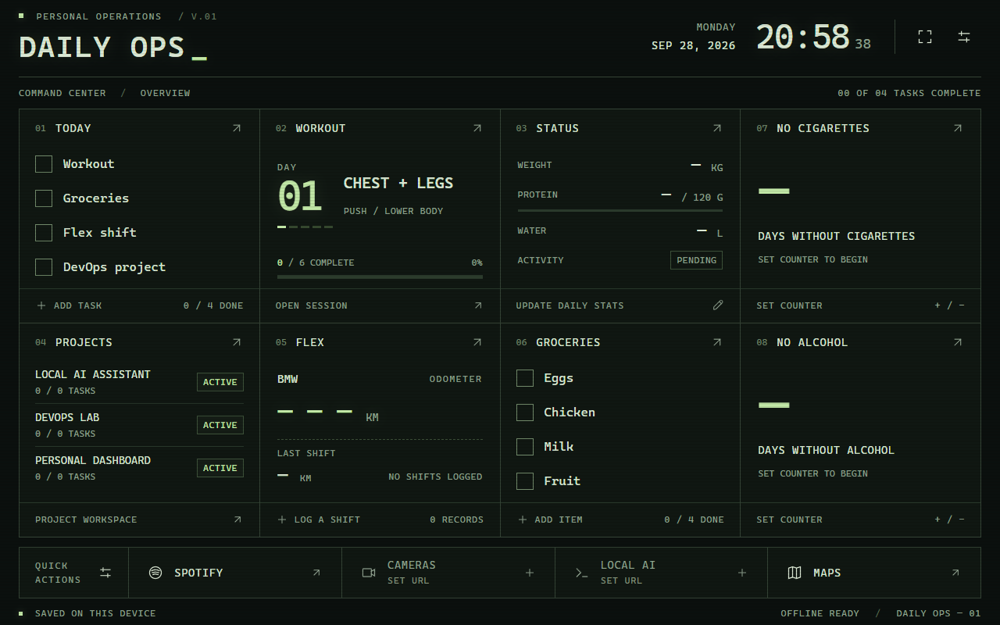

# DAILY OPS

A working, local-first personal command center with browser/PWA, iOS, and Android versions. It preserves the original terminal dashboard built for the Tab S7 FE: thin panel dividers, large touch targets, and an optional subtle CRT overlay. The responsive layout supports tablets and phones.

**Android:** see [build, installation, startup, and device checks](docs/ANDROID.md). On this Windows checkout, run `build-android.cmd` to rebuild `artifacts/app-debug.apk`. The installed app bundles its own UI and does not need a laptop server.

**Continuing on a Mac:** follow [Mac setup and transfer instructions](docs/MAC-SETUP.md), then read the [project handoff](docs/MAC-HANDOFF.md). Current XB10 monitoring, verified counters, and connection limitations are recorded in [the network dashboard notes](docs/IPAD-NETWORK-DASHBOARD.md).

**iPhone and iPad:** Daily Ops 1.3.0 (build 8) is installed on the iPhone 14 Pro and iPad mini 4. Task edits were confirmed in both directions using the same Daily Ops account. See [iOS installation and device checks](docs/IOS.md).

**Cloud sync:** start with the [Supabase quickstart](docs/SUPABASE-QUICKSTART.md), then see [setup, privacy, and verification](docs/CLOUD-SYNC.md). The optional XB10 modem feed remains unavailable; task sync works independently. Before publishing source or sharing backups, read the [security notes](SECURITY.md).



## What works

- **Today:** add, edit, delete, and check off tasks.
- **Groceries:** the same checklist controls, with quick checks on the dashboard.
- **Workout:** manually select any of the five requested rotation days; open the session and check off sample exercises. Progress is saved for each local calendar date and rotation day.
- **Flex / Driving:** BMW and Subaru mileage logs; starting/ending odometers, date, shift, route difficulty, automatic distance, history, editing, and deletion.
- **Daily status:** dated weight, protein consumed/goal, water, and walking/activity completion. You can select a date to edit an earlier entry.
- **Day counters:** large counters for days without cigarettes and days without alcohol. Tap either counter to enter the current number, adjust it with +/−, or reset to zero, then save. Each increases automatically at local midnight. An unset counter shows a dash until you start it.
- **Projects:** add, rename, change status, delete, and manage a small task list per project.
- **Quick actions:** edit the names and web URLs of Spotify, Cameras, Local AI, and Maps shortcuts.
- **Device tools:** updating clock/date, fullscreen control, CRT toggle, JSON backup export/restore, storage-protection request, and an installable offline production build.
- **Theme:** tap THEME in the header. Dark, AMOLED, Midnight Blue, Samsung Blue, Dark Red, Light, and Custom; eight editable colors, immediate local saving, and Reset to Default. Dark Red combines near-black panels, muted red accents, and burgundy buttons. Updates preserve your existing theme selection.
- **Clock view:** tap the date or time to open a large live clock using the current theme. Date and seconds update automatically. Return with Back to dashboard, Escape, or Android Back. Opening the clock does not change your settings.
- **iPad live network:** WAN download/upload traffic from verified XB10 byte counters, about two-second updates, recent history, and explicit stale/unavailable states. UPnP must be enabled; its service address can change after a restart. The web/Android view explains the current iOS-only direct-reading support.
- **Optional account sync:** share tasks, workouts, stats, counters, groceries, mileage, projects, shortcuts, and theme between devices. Offline edits are saved locally; competing edits require review. Each account has its own private dashboard. Home modem readings can also be shared when a home device has a working gateway connection.
- **Android wrapper:** stays awake while active, visible Android navigation by default, optional fullscreen toggle, a HOME button, landscape orientation, Android backup file picker, and external quick-action links. It is a regular app and does not replace the tablet's launcher.

Starter task/grocery lists and project names come from the brief. Health and mileage start empty. Workout exercises are a demonstration plan. Cameras and Local AI open configuration until you give them URLs. Network readings come from the local gateway; unavailable metrics are not fabricated.

## Run this checkout on this Windows computer

Dependencies are already installed. From PowerShell:

```powershell
cd C:\Users\sri26\workspace\daily-ops
.\start.cmd
```

Open **http://localhost:5173/**. Stop the server with **Ctrl+C**. If the server is already running, use its existing page; strict ports prevent a second process from silently choosing another address.

The Windows launcher uses Node on PATH when present, or the existing Codex bundled Node runtime on this computer. It does not require a global npm/pnpm installation just to start this installed checkout. On another computer, follow the portable setup below.

To preview the existing production build:

```powershell
.\start.cmd --production
```

Open **http://localhost:4173/**. Rebuild after source changes.

## Portable installation

Use **Node.js 22.12 or newer** (tested here with Node 24.19) and **pnpm 10.28.2**. Vite's Node requirements are documented in the [Vite guide](https://vite.dev/guide/).

```sh
npm install --global pnpm@10.28.2
pnpm install --frozen-lockfile
pnpm dev
```

The committed lockfile pins the resolved dependencies, including patched build tools. Use the pinned pnpm version to preserve those overrides. Runtime dependencies include React, React DOM, Capacitor, and the Supabase client. Local-only use requires no account or environment file; cloud sync requires the configuration described in [CLOUD-SYNC.md](docs/CLOUD-SYNC.md).

## Architecture and technology choices

```text
React views and native controls
             |
useDashboard (state updates and save/error handling)
             |
Pure domain functions + typed data
             |
Validated repository
             |
Browser localStorage / Android private preferences (versioned JSON)
```

**React + TypeScript:** small composable views and a typed data model make this an understandable learning project. TypeScript checks form and record shapes across features. React state is enough; a global state library and client-side router would add little to this single-screen application.

**Vite:** a quick local development server and a static production build. There is no server rendering requirement. The build can be served by any ordinary static host later.

**Plain CSS:** design tokens, CSS Grid, media queries, and system monospace fonts keep the terminal look distinct and self-contained. No Material UI, CSS framework, downloaded fonts, icon package, or image CDN is involved.

**Native HTML:** real checkboxes, labels, forms, selects, progress elements, and a modal dialog supply keyboard support and browser focus behavior. The drawer traps focus, closes with Escape, restores focus, and has visible return controls. Most controls have a minimum 44 px target; form inputs are 48 px.

**Local storage adapters:** the browser uses localStorage, Android uses private SharedPreferences, and iOS uses protected Application Support files. Native saves confirm the disk write before showing success. The adapters use the same validated JSON and repository interface. Optional Supabase sync saves its accepted revision alongside local records and reconciles changes without replacing unreviewed competing edits.

**Small build-generated service worker:** caches only the static application shell. No third-party PWA framework is necessary. User data remains in localStorage. Assets are versioned from their content hash.

**Capacitor 8:** wraps the same `dist/` build in an Android WebView. There is no remote server URL. The native build skips service-worker registration so APK upgrades immediately use the bundled assets. A small Java Activity/plugin adds display behavior, safe external links, return to Home, and document export. The Activity adds its awake flag on resume and clears it on pause. Navigation is visible whenever it reopens; fullscreen is an explicit, temporary choice. There is no Home-app role, background service, device-owner role, or broad storage permission. See [Capacitor Android support](https://capacitorjs.com/docs/android).

**Themes:** eight validated hex colors are stored under `settings.theme` in the existing versioned JSON. CSS variables apply them to the existing components; derived shades and button contrast work with light and dark palettes. Missing themes in older backups are migrated to the original default without changing the other records.

## Folder structure

```text
daily-ops/
  android/                Native Android project, Activity, and local plugin
  ios/                    Native iOS project, storage, Keychain, and gateway bridges
  supabase/               Database migrations and account-isolation verification
  capacitor.config.ts     App identity and bundled dist/ directory (no remote URL)
  public/                 App manifest, terminal icon, install icons
  src/
    App.tsx               Dashboard overview, clock, fullscreen, drawer routing
    styles.css            Shared terminal theme and responsive layouts
    main.tsx              React entry point
    components/           Checklist, native dialog, small SVG control icons
    domain/model.ts       Data types, workout templates, task/mileage rules
    domain/theme.ts       Theme presets, validation, derived CSS colors
    data/repository.ts    Schema validation, serialization, storage, restore
    data/nativeStorage.ts Android adapter and one-time WebView data migration
    data/useDashboard.ts  React state, persistence errors, cross-tab refresh
    features/             Detailed screens for the MVP sections
    sync/                 Authentication, durable merge, cloud and home-feed sync
  scripts/build-sw.mjs     Offline cache generation after a production build
  tests/
    domain.test.ts        Important rules and persistence failure cases
    browser/              End-to-end workflows, offline and responsive checks
  playwright.config.ts
  vite.config.ts
  tsconfig.json
  package.json
  pnpm-lock.yaml
  start.cmd               Convenient Windows launcher
  README.md
```

## Data and persistence behavior

Browser data lives under **`daily-ops:data:v1`** in localStorage. It survives normal refreshes, browser restarts, and application restarts in the same browser profile and origin. An origin includes **scheme, hostname, and port**: localhost, a LAN IP, HTTP/HTTPS, and development/production ports have separate data. Android 1.1.1+ stores the same JSON in private preferences, confirms each disk write, and migrates the previous WebView copy once without changing its contents. The original copy remains untouched; subsequent reads and writes use the native store. An invalid migration or failed save shows a recoverable error rather than resetting data.

- Tasks and groceries persist until changed; they do not reset at midnight.
- The selected workout day persists. Exercise checks use `YYYY-MM-DD/day` keys, so a new date starts a fresh checklist.
- Health entries use local calendar dates. Missing measurements display a dash, not zero. The initial protein goal is 120 g for each unrecorded date.
- Day counters store separate start dates. The saved count is derived from calendar dates, with zero on the start date, avoiding daylight-saving time errors. Older v1 data and backups automatically gain unset counters without losing existing records; they save the added fields on the next change.
- Mileage records have stable IDs, vehicle, date, odometers, shift, difficulty, and creation time. Distance is derived rather than duplicated. The dashboard shows the highest recorded ending odometer for the selected vehicle and the last shift by date, then creation time. Backdated records are allowed; cross-record odometer continuity is not enforced.
- Projects have stable IDs, names, statuses, and nested checklist tasks.
- Shortcuts store `{ id, name, kind: "url", target }`. Only HTTP(S) URLs without embedded credentials are accepted. A future app-link action can add a new `kind`, validation, and a launch handler.
- Settings and records share `schemaVersion: 1`. Future schema versions must add an explicit migration; unknown formats are rejected rather than reset.
- Saving happens before the UI confirms a change. If storage is full or blocked, the form retains input and displays an error.
- Invalid saved data is left untouched. Recovery offers a raw export, a valid-backup restore, or retry.
- Open tabs receive storage events. Changes read the latest saved snapshot first; this is still a simple last-write-wins store, not conflict-free collaboration.
- Individual lists are limited to 10,000 items, and serialized data/backups to 4 MB. Larger datasets should move to IndexedDB or a backend.

Use **Settings → Export backup** regularly. Restore validates the whole file and asks you to confirm replacement; it does not merge. Backups contain your personal records in plain JSON, so keep them in a location you trust.

Clearing site data, using a private/incognito session, browser eviction, or losing the device can remove local records. The optional storage-protection request asks the browser to reduce eviction risk; it cannot replace backups. Connected accounts also save their current dashboard in Supabase. This shared copy is not a historical backup; keep separate JSON exports.

## Tablet, fullscreen, and offline use

1. Start the application on your computer. Keep the computer and tablet on the same network.
2. Open the server's **Network** address on the tablet, for example `http://<computer-LAN-IP>:5173` for development or port `4173` for production preview. The server prints the available addresses. If blocked, allow the chosen local server through the firewall on your private network.
3. Turn the tablet to landscape and use the fullscreen button in the header. This is kiosk-style presentation; Android navigation remains available. No rooting or Android modifications are needed.
4. For home-screen installation and reliable offline launch on Android, serve **the production build over trusted HTTPS**. In Chrome/Samsung Internet, use the available **Install app / Add to Home screen** menu. Browser wording and fullscreen support vary.
5. Load it once online and wait for **OFFLINE READY** in the footer. The installed app can then launch and save changes without a connection.

A plain LAN HTTP address can run the dashboard and save data while the server is reachable, but it does **not** enable service-worker offline loading or normal PWA installation. `localhost` is a special development exception only on the same device. Installation, manifest, and secure-context requirements are described in [MDN's PWA guide](https://developer.mozilla.org/en-US/docs/Web/Progressive_web_apps/Guides/Making_PWAs_installable).

The web manifest requests fullscreen and landscape. These are browser hints; the responsive UI still works when the browser overrides them. The browser version does not automatically keep the screen awake. The standalone Android APK uses native fullscreen and a screen-awake flag; see [Android setup](docs/ANDROID.md).

Development does not register a service worker. Production caches its own fonts/styles/scripts/icons; no internet font or image service is needed. A new app version waits for all existing app tabs/windows to close before activation, avoiding a forced refresh while a form is being edited. Close all windows, then reopen after deploying an update. Back up before changing the app's origin.

## Production build

```sh
pnpm build
pnpm preview
```

`build` type-checks, creates `dist/`, then generates `dist/sw.js`. `preview` serves it on port 4173 for verification. The Windows launcher can preview a built `dist/` via `.\start.cmd --production`.

For later hosting, serve **only `dist/` at the domain root** over HTTPS. The MVP uses root-relative paths. Use a stable origin to retain device data. Serve `sw.js`, `index.html`, and the manifest without long-lived caching; hashed assets can use immutable caching.

A later Docker deployment needs only a Node build stage followed by a static Nginx or Caddy stage containing `dist/`; HTTPS can terminate at a reverse proxy. No application server or database container is needed for this version. Docker configuration, remote hosting, and automatic deployment are intentionally roadmap work.

## Tests and code style

```sh
pnpm typecheck
pnpm test
pnpm build
pnpm exec playwright install chromium
pnpm test:browser
pnpm format:check
```

Browser tests automatically start a production preview server and use isolated test contexts. They test task/grocery CRUD, workout selection and persistence, mileage calculation and vehicle separation, stats, projects, shortcuts, offline reload, backups, storage recovery, and layout/focus behavior.

If Chrome is already installed, it can be used without downloading Chromium:

```powershell
$env:PLAYWRIGHT_CHANNEL = "chrome"
pnpm test:browser
```

`pnpm format` formats the source. `pnpm test` uses Node's test runner through tsx; there is no separate unit-test framework. Playwright is development-only. Failed browser tests retain screenshots and traces in ignored `test-results/`.

Browser verification targets include 1280 × 800 landscape, 800 × 1280 portrait, and 390 × 844 mobile. Physical SM-T387W APK checks are recorded separately in the [device report](docs/ANDROID-VERIFICATION.md).

Current version 1.3.0 verification: 44 Node unit tests, 6 Python gateway-probe tests, and 20 browser tests passed. Signed builds and installation passed on the iPhone and iPad, with saved records verified unchanged after updating. The user confirmed physical task edits in both directions on 2026-10-10. Detailed results and remaining network checks are recorded in [CLOUD-SYNC.md](docs/CLOUD-SYNC.md), [IOS.md](docs/IOS.md), and [IPAD-NETWORK-DASHBOARD.md](docs/IPAD-NETWORK-DASHBOARD.md).

Earlier baseline verification on 2026-10-08: 24 domain/persistence tests and 12 browser tests passed; the production build and TypeScript checks passed. Coverage includes native storage migration/failure handling and the live clock across midnight. The landscape fit check confirms no page scrolling at 1280 × 800 with the default content. The smaller tablet retains the responsive scrolling layout. Device tests additionally verify visible Home/Recents controls, foreground-only awake behavior, optional fullscreen, and the clock fitting with system navigation visible.

## Future architecture possibilities

Keep each step incremental:

1. **Larger local data:** introduce IndexedDB for extensive workout history, mileage history, and graphs.
2. **Alternative hosting:** adapt the existing authenticated sync transport for a self-hosted backend if needed, preserving ownership checks, server revisions, and conflict handling.
3. **Integration adapters:** Google Calendar, weather, Spotify, Home Assistant, camera/farm monitoring, and a local AI/Ollama service. Keep service secrets on a backend; expose a small frontend adapter per integration.
4. **Device features:** Android notifications, reminders, app deep links, voice input, and a browser wake-lock option. The native Android screen-awake flag is already implemented.
5. **Richer records:** workout history views, weight graphs, Flex analytics, meal tracking.
6. **Web deployment:** a static Docker image, trusted HTTPS, and a stable host name. Installed iOS apps already connect directly to Supabase without a Mac server.

Those additional integrations, analytics, voice, notifications, and hosting options remain future work.
