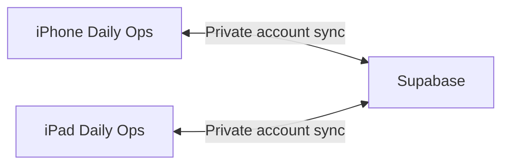

# Supabase for your Daily Ops app

Supabase runs the online database and account service that your devices share. Daily Ops still saves records on each device, so it can work offline. Your Mac builds and installs the app; it does not need to stay connected for cloud sync.

Task sync was confirmed in both directions on the physical devices on 2026-10-10. You can edit records from your phone while the iPad is closed; it catches up when Daily Ops next opens online. The optional modem feed is currently unavailable, and troubleshooting was left for later at your request. That feed needs the home iPad connected to the gateway with Daily Ops open. Cloud sync does not remotely wake the iPad or launch its app.

## Two accounts with different jobs

Your Supabase dashboard account manages the project. Your Daily Ops app account signs into the app. Use the **same Daily Ops app account** on the iPhone and iPad. Creating another app account creates a separate private dashboard.

The app's row-level security rules let a signed-in account read and change only its own rows. The project dashboard gives you administrative access to the database. A publishable app key identifies the project; the signed-in session and database rules control access. The app does not contain a secret or service-role key.

## Find your records

Open [your project](https://supabase.com/dashboard/project/bwwlowouskuebzykbleu), then use the project menu:

| Place                                   | What it shows                                                                                                                                         |
| --------------------------------------- | ----------------------------------------------------------------------------------------------------------------------------------------------------- |
| Authentication → Users                  | The app accounts and their confirmation state.                                                                                                        |
| Table Editor → `daily_ops_dashboards`   | One current dashboard per app account. `document` holds the records; `revision` increases on a successful write; `updated_at` shows the latest write. |
| Table Editor → `daily_ops_home_traffic` | The latest optional home download/upload readings and sample time. It is not a traffic-history archive.                                               |
| Observability → Logs                    | Recent requests and errors for troubleshooting.                                                                                                       |
| Advisor Center                          | Database security and performance findings.                                                                                                           |

Make everyday edits in Daily Ops so its validation and conflict handling apply. You do not need to edit database rows manually.

## A small practice session

You already completed steps 1 and 2 to verify sync. Steps 3 and 4 are optional learning exercises.

1. Keep Daily Ops open and online on both devices. Add a task named **Sync check** on the iPhone.
2. Check the iPad after about five seconds. Mark that task complete on the iPad, then check the iPhone.
3. Look at the dashboard row's `revision` and `updated_at` in Table Editor. They should advance after each saved change.
4. Briefly disconnect the iPhone from the internet, add another task, then reconnect and reopen Daily Ops. The saved offline change should sync. If both devices edited the same field, review the competing values before choosing.

The app checks remote revisions every five seconds while open. **SYNCED** means the latest sync completed; **SYNCING** means an update is in progress, and **OFFLINE** means the device cannot currently sync. If you resume modem setup later, use the iPad as the home source and keep sharing off on the traveling phone. **HOME STALE** means the latest modem reading is more than 15 seconds old.

## Free plan, pauses, and backups

As checked on 2026-10-10, the Free plan is $0/month, includes a 500 MB database and 5 GB egress, and does not include automatic backups. Watch usage in the dashboard. [Supabase pricing](https://supabase.com/pricing).

Free projects may pause after a week of low database activity. If paused, open the project and choose **Resume project**. The current documentation allows restoration within one year of pausing, including data and configuration. Cloud sync will be unavailable during the pause; locally saved records remain on the devices. [Supabase project pausing](https://supabase.com/docs/guides/platform/free-project-pausing).

Use Daily Ops Settings to export periodic JSON backups to Files. A connected dashboard is a shared current copy, so deleting or restoring records can also change the other device. **EXPORT PRE-SYNC COPY** saves the original records kept before that installation first joined sync.

For technical setup and the actual verification record, see [CLOUD-SYNC.md](CLOUD-SYNC.md).
